# Beta Blast

A bouldering-themed bubble shooter. Fire holds at the wall, match three or more of the same hold to pop them, and cut off the rest so they fall. Clear the whole wall to **send** the route.

Found a bug or have an idea? [Open an issue](https://github.com/OwainWilliams/Beta-Blast/issues/new).

Built with TypeScript, [Phaser 3](https://phaser.io) and Vite. All art and sound is generated in code, so there are no asset files.

## Screenshots

<table>
  <tr>
    <td align="center">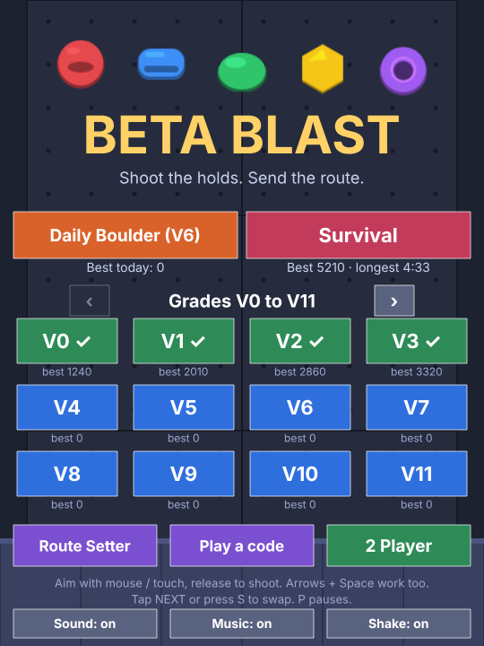<br><sub>Menu</sub></td>
    <td align="center">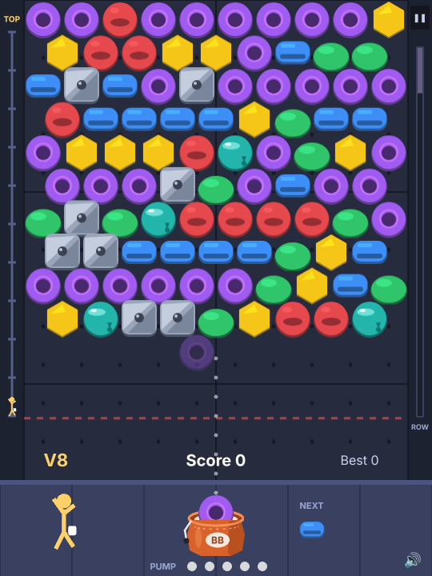<br><sub>Aim and shoot</sub></td>
    <td align="center">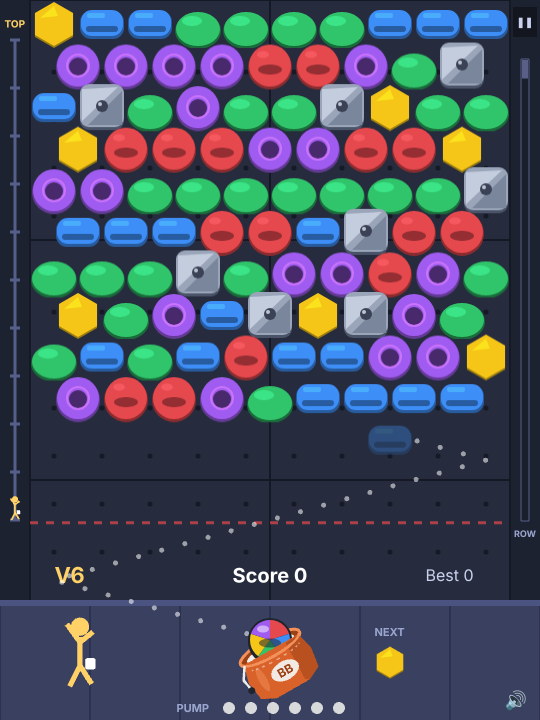<br><sub>Mega jug wildcard</sub></td>
    <td align="center">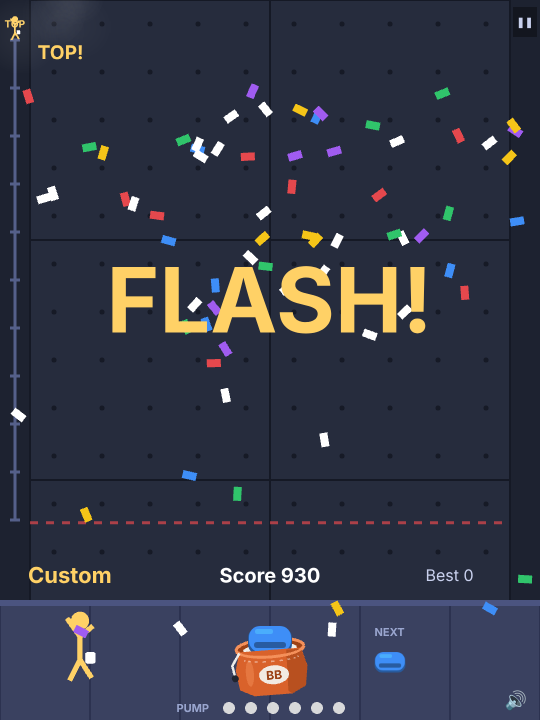<br><sub>Flash!</sub></td>
  </tr>
  <tr>
    <td align="center">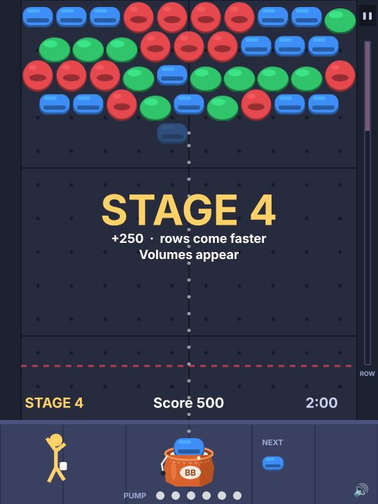<br><sub>Survival stages</sub></td>
    <td align="center">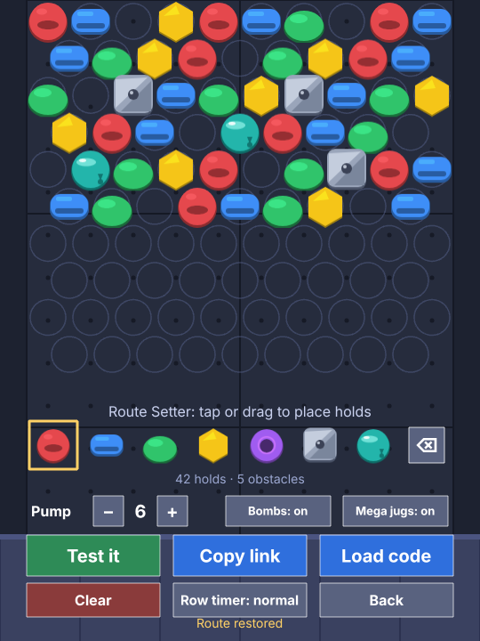<br><sub>Route Setter</sub></td>
    <td align="center">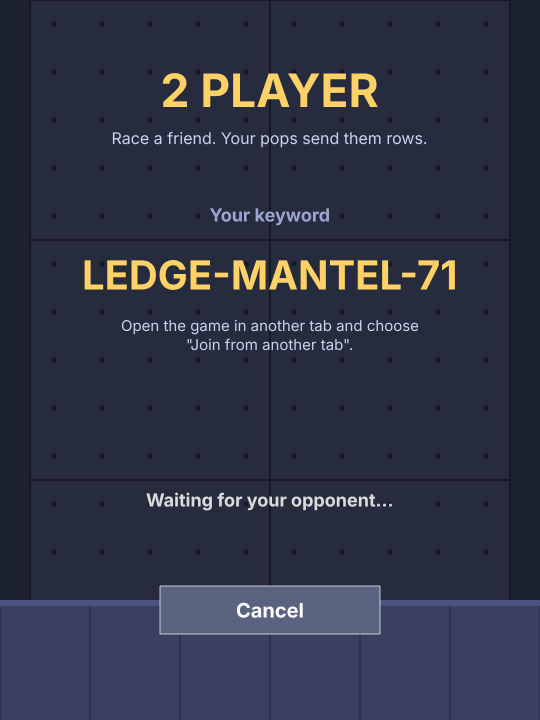<br><sub>2 Player lobby</sub></td>
    <td align="center">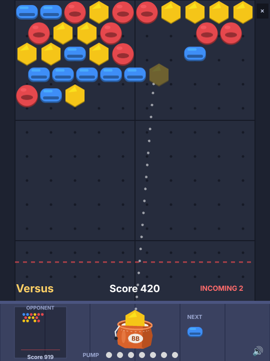<br><sub>Versus match</sub></td>
  </tr>
  <tr>
    <td align="center">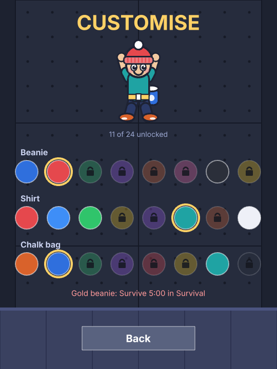<br><sub>Customise</sub></td>
    <td align="center">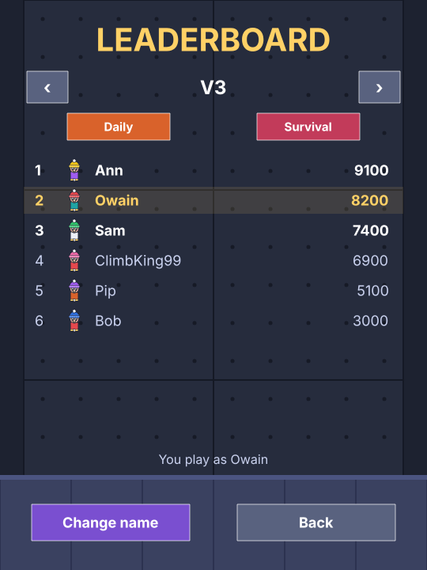<br><sub>Leaderboard</sub></td>
  </tr>
</table>

Regenerate them with `npm i --no-save playwright && npx playwright install chromium`, then `node scripts/screenshots.mjs`.

## Run it

```bash
npm install
npm run dev      # http://localhost:5173
npm test         # unit and fuzz tests
npm run build    # production build in dist/
```

## How to play

- **Aim**: move the mouse or drag a finger. Arrow keys / A / D also work. The chalk bag leans toward your aim and a ghost hold shows where your shot will land.
- **Shoot**: release the click or tap, or press Space.
- **Swap**: tap NEXT, or press S.
- **Pause**: P or Esc (or the button top right). **Mute**: M. **Restart**: R.

Each colour of hold (jug, crimp, sloper, pinch, pocket) also has its own shape, so the game is playable without relying on colour.

**Pump**: each shot that pops nothing fills a pip. When the pips fill, the wall drops a row. Reach the red line and you fall.

**Row timer**: a gauge down the right edge fills with time, and when it is full the wall drops another row, so a game that drags on keeps getting harder. The higher the grade, the faster it fills (90 s at V0, about 38 s at V12, never faster than 20 s). Any new row restarts it, and a clear before the first timed row still earns FLASH.

**Survival**: a mode with no finish line. The wall keeps coming on a timer that speeds up as the stages go by (a stage every 40 s: rows start every 11 s and tighten 5% per stage down to 4.5 s). The wall starts with 3 colours, gets a fourth at stage 3, volumes at stage 4, all five colours at stage 5 and slick holds at stage 6. Each new stage pays +250 and the music picks up the pace. Clear every colour and you get a **clean sweep**: +500 and three fresh rows arrive at once. The run ends when the wall reaches the red line, and your best score and longest run are saved.

**2 Player** (menu, bottom right): race a friend over the internet.

- **Host a game** gives you a keyword like `CHALK-DYNO-58` and a link. Your friend picks **Join a game** and types the keyword, or just opens the link. When they connect you press Start.
- Both players get the **same wall and the same stream of holds** (dealt from a shared seed), so the match is decided by play, not luck.
- Every **connection** (a pop) sends your opponent a row, and cutting off 4 or more holds sends a second. Rows sent to you wait in a queue and land together when you **miss**; popping first **cancels** queued rows, and only the surplus is sent on. Clear every colour and you send 4 rows and get a fresh wall. Reach the red line and you lose.
- The opponent's wall is shown in miniature at the bottom left, with their score and the rows queued against them.
- The host can start a **rematch** on a new shared wall. There is no pause in a match; the ✕ button asks whether you want to forfeit.
- **Same device**: open the game in two tabs and use *Host in this tab* / *Join from another tab*.

Good to know:

- Players connect **directly (WebRTC)**. To introduce them, the game uses PeerJS's free public matchmaking service, which sees the keyword and both players' IP addresses, and the browser's default STUN servers are used to find a route. Your opponent also sees your IP address, as in any peer-to-peer game.
- Some networks (strict firewalls, some mobile carriers) block direct connections, and there is no relay, so those players will see "Couldn't connect". Nothing is sent after a match ends.
- Messages from the other player are treated as untrusted: they are checked field by field before use. It is still a friendly game, not an anti-cheat one: each browser runs its own game and trusts the other's reports of rows sent.
- To use your own matchmaking server, build with `VITE_PEER_HOST` (and optionally `VITE_PEER_PORT`, `VITE_PEER_PATH`, `VITE_PEER_SECURE=false`).
- The rules (what a connection sends, whether rows wait for a miss) are a few lines in `src/game/versus.ts`.

**Music**: a procedural loop with no audio files. The grade picks the chords and melody and sets the tempo (96 BPM at V0, up to 150). More layers join in as the wall gets low or the timer runs down. Toggle it in the pause menu or main menu.

**Combo**: pop on back-to-back shots to build a multiplier (up to x2).

**Special holds**
| Hold | Behaviour |
|---|---|
| Chalk bomb (V2+, a white ball you shoot) | Clears itself and every hold touching it, obstacles included |
| Mega jug (V1+, a rainbow ball you shoot) | A wildcard: it turns into whichever colour pops the most where it lands. The ghost preview shows the colour it will become |
| Volume (grey block, V4+) | Takes two pops next to it to break. Can't be matched |
| Slick (teal, V7+) | A shot that lands beside one slides down and away |

You send a route when every coloured hold is gone. Any obstacles left tumble off.

**Scoring**: pops, drops (cut-off holds), bank shots (bonus per wall bounce), a route bonus per grade, and **FLASH** (+500) for sending without being pumped. Sending faster pays a **speed bonus**: every second under a par time is worth points (12 a second on V0, more on harder grades), and a live counter above the bottom bar shows what a send is worth right now. Time spent paused, or watching the animations, doesn't count.

**Modes**: endless grades (V0, V1, V2... with no top, shown 12 to a page), and a **Daily Boulder** that is the same seeded route for everyone each day. Best scores and sends are saved in local storage.

**Route Setter**: build your own route (10 rows, all hold types, pump limit, bombs and mega jugs on/off, row timer off/slow/normal/fast), test it, and share it as a link or code. Anyone opening `?route=CODE` plays it straight away, or use *Play a code* in the menu.

**Customise**: pick your climber's beanie, shirt and chalk bag (*Customise* in the menu). Each colour is unlocked by playing: sending grades, sending Daily Boulders, lasting in Survival, or a big score. Locked ones show how to earn them. Your climber appears next to your name on the leaderboard.

**Accounts** (optional): tap **Sign in** on the home screen to sign in with GitHub or Google. Your best scores, grades sent, tips seen and outfit then follow you to every device, and your leaderboard name is yours: nobody else can post under it, and a ✓ marks it on the leaderboard. Playing as a guest works exactly as before, with the save kept on that device. Players can delete their account, scores and cloud save from the Account screen. Sign-in is off until the OAuth apps are set up: see [docs/accounts-setup.md](docs/accounts-setup.md).

**Leaderboard**: after a grade, the Daily Boulder or a Survival run, pick a name (letters and numbers, up to 12) and post the score. Each grade, each day's Daily and Survival has its own top 10, under *Leaderboard* in the menu. Custom routes and two-player matches have no board. The game works fine if the API is down. Scores are checked by the API (see *Cheating* below).

## Balance

`npm run balance` has a bot play grades V0 to V20 (set `TOP_GRADE=` for more) and prints win rates at two skill levels, with the row timer running at 2.2 s per shot (`SHOT_SECONDS=`), so difficulty changes can be checked against numbers. It also reports how long the bot lasts in Survival. The bot is greedy and never swaps, so it is a guide, not a replacement for playtesting. Tuning lives in `src/game/levels.ts`.

## Project layout

```
src/game/grid.ts     hex grid, matching, floating holds (pure)
src/game/engine.ts   the rules: shots, scoring, combo, pump, special holds, survival, versus (pure)
src/game/levels.ts   grades, seeded RNG, daily route, survival and versus levels
src/game/routes.ts   share codes for custom routes
src/game/versus.ts   the rules of a two-player match
src/game/music.ts    procedural background music
src/game/audio.ts    synthesised sound effects
src/game/storage.ts  saved scores and settings
src/net/             protocol, keywords, transports (WebRTC, same-browser, in-memory), match session
src/game/leaderboard.ts  client for the leaderboard API
src/game/boards.ts   board ids and names, shared with the Worker and the widget
src/embed/           the embeddable leaderboard widget (built on its own to dist/embed.js)
public/              files copied as they are, such as the widget demo page
src/game/looks.ts    the climber's outfits, what unlocks them, and the look code
src/game/account.ts  signing in and syncing the save, from the game's side
src/game/saveMerge.ts how two copies of a save are merged (shared with the Worker)
src/game/replay.ts   records a round's moves and plays them back, for checking scores
src/scenes/          Boot (draws textures), Menu, Game, Editor, Lobby, Leaderboard, Customise, Account
worker/              the leaderboard API: a Cloudflare Worker with a D1 database
src/overlays.ts      result, leave and pause screens
src/effects.ts       chalk bursts, floating text, confetti
src/hints.ts         the one-off tips
tests/               vitest (see below)
```

## Leaderboard API

The leaderboard is a small [Cloudflare Worker](https://developers.cloudflare.com/workers/) in `worker/` with a [D1](https://developers.cloudflare.com/d1/) (SQLite) database, both on the free plan. GitHub Pages only serves files, so this is the one moving part.

- The game uses `GET /scores?board=v3` (the top 10, each with the player's `look`, never cached). `POST /scores` takes `{ board, name, score, seconds?, look?, replay }` and keeps each name's best score per board. A player's look is stored once per name, so their climber is the same on every board. Signed-in players post with `Authorization: Bearer <token>`, and their scores go under their account's name. Guests can't post under a name an account has claimed.
- It only accepts posts from the origins listed in `worker/src/index.ts`, limits each address to 10 posts a minute, and rejects rude names (`worker/src/rules.ts`).
- `.github/workflows/deploy-worker.yml` creates the tables (`worker/schema.sql`) and deploys the Worker whenever `worker/` changes on `main`. It needs the repository secrets `CLOUDFLARE_API_TOKEN` (the *Edit Cloudflare Workers* template plus *Account, D1, Edit*) and `CLOUDFLARE_ACCOUNT_ID`.
- The game finds the API through `API_URL` in `src/config.ts`. Set `VITE_API_URL` to use another one, or to an empty string to switch the leaderboard off.

### Public read API

Anyone can read the leaderboard from any website or script. Replace the address below with the Worker's own (the default is in `src/apiUrl.ts`). Answers are JSON, open to every origin, and cached for 30 seconds. Posting scores stays limited to the game's own sites.

| Endpoint | Returns |
|---|---|
| `GET /v1` | The list of endpoints |
| `GET /v1/boards` | Every board that has scores, with its title, entry count and top score |
| `GET /v1/boards/{board}?limit=10` | The top scores on a board |
| `GET /v1/players/{name}` | A player's best score and rank on every board |

Boards are `v0`, `v1`, ... for grades, `survival`, and `daily-YYYY-MM-DD`. Use `daily` for the current Daily Boulder.

```bash
curl https://beta-blast-api.owaingdwilliams.workers.dev/v1/boards/daily?limit=3
```

```json
{
  "board": "daily-2026-10-12",
  "title": "Daily Boulder",
  "kind": "daily",
  "scores": [
    { "rank": 1, "name": "Ann", "score": 9100, "seconds": 0, "look": "742",
      "outfit": { "beanie": "#f5c518", "shirt": "#a05cf0", "bag": "#e5484d" } }
  ]
}
```

`seconds` is the length of a Survival run (0 on other boards). `verified` is true when the name belongs to a signed-in player. `outfit` has the colours of the player's climber as CSS hex, so a page can draw it without knowing the palette. Names are public, the same as on the leaderboard in the game.

### Embedding the leaderboard

The widget is one script tag. It draws where the tag is, in its own shadow root so the page's styles can't break it (and it can't break the page).

```html
<script src="https://thesecretstage.vip/Beta-Blast/embed.js" data-board="daily" async></script>
```

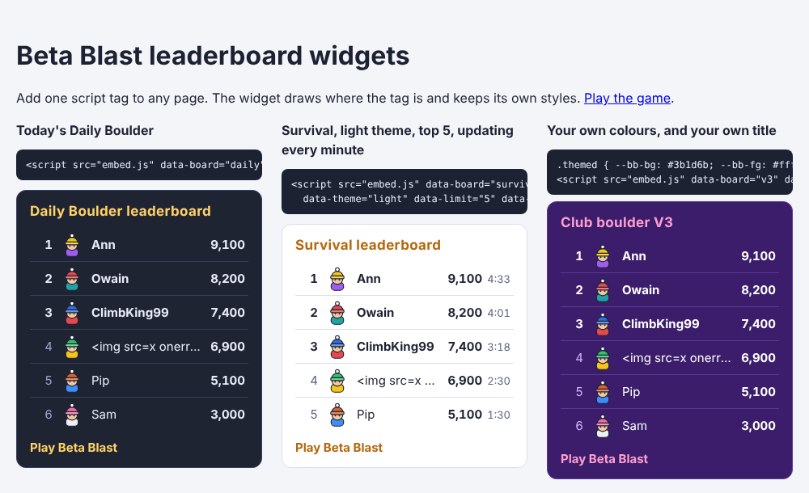

Set options as `data-` attributes on the tag:

| Attribute | Default | |
|---|---|---|
| `data-board` | `daily` | `daily`, `survival`, `v3`, `daily-2026-10-12`... |
| `data-limit` | `10` | Rows to show, 1 to 10 |
| `data-title` | the board's name | The heading |
| `data-theme` | `dark` | `dark`, `light`, or `auto` (follows the visitor's setting) |
| `data-refresh` | off | Seconds between updates, at least 15 |
| `data-target` | after the tag | A CSS selector for the element to draw into |
| `data-link` | shown | `false` hides the "Play Beta Blast" link |
| `data-game` | this game | Where the link goes |
| `data-api` | this API | Use another API address |

The colours can be set from the page's own CSS: `--bb-bg`, `--bb-fg`, `--bb-muted`, `--bb-line`, `--bb-accent` and `--bb-highlight`. `window.BetaBlast.mount(element, options)` draws a board from your own code. See `public/embed-demo.html` (served at `/embed-demo.html`) for working examples. The script is about 3 kB gzipped; `npm run build` makes it as `dist/embed.js`.

### Cheating

Every score is posted with a replay of the round, and the Worker checks the score against it before it goes on the board. The replay code is in `src/game/replay.ts`. For a stricter check, `VERIFY_REPLAYS = "1"` in `worker/wrangler.toml` makes the Worker replay every round through the game engine itself. That uses more CPU than the Workers *Free* plan allows, so it needs the *Paid* plan.

## Tests and checks

```bash
npm run typecheck   # strict TypeScript
npm test            # unit tests, plus the fuzz tests below
npm run balance     # optional: the difficulty bot
```

The rules are pure TypeScript with no Phaser in them, so most of the game is tested without a browser:

- **Unit tests** for the grid, engine, levels, route codes, saves, music patterns and the network layer. The PeerJS transport is tested against an in-memory stand-in for PeerJS.
- **Fuzz tests** (`tests/fuzz.test.ts`) play hundreds of random games across every mode and check, after every shot, that the wall is consistent, nothing hangs in mid-air, nothing is removed twice and the score never goes down. They also throw 20,000 junk messages at the network parser. They count which cases they reached, and fail if any (bombs, mega jugs, slick holds, clean sweeps, incoming rows) never came up.
- The leaderboard tests run the Worker's real SQL against SQLite (Node's built-in `node:sqlite`), using the real `schema.sql`. The replay tests have a bot play real rounds and check each one plays back to the same score, and that edited or cut-short replays are refused.
- **CI** runs the type check, the tests and the build on every pull request.

## Ideas for later

Crumbling holds, a leaderboard for the daily route (needs a small backend), a relay server for players whose networks block direct connections, spectating, installable PWA.
